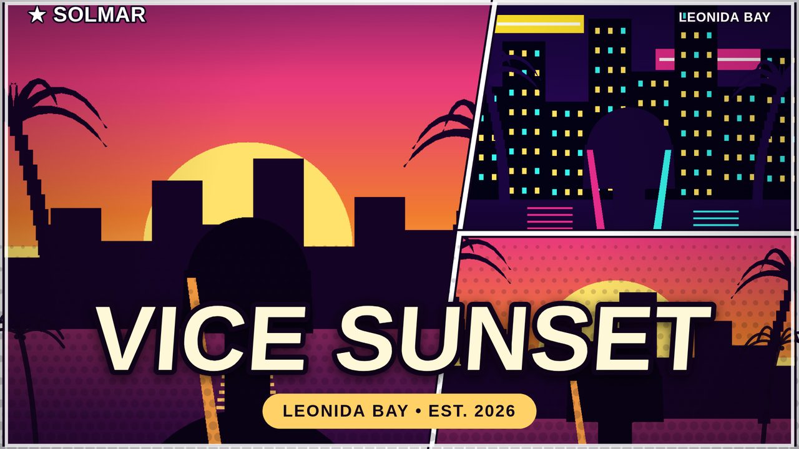

# SOLMAR COVER — GTA-style cover art maker

[](https://make.fun/bounty/gta6-cover-art-01)
[](https://make.fun/bounty/gta6-cover-art-01)
[](https://make.fun/bounty/gta6-cover-art-01)

Turn your photo into GTA-style multi-panel cover art: bold poster lettering,
a Vice City sunset or neon colour grade, palm silhouettes, halftone dots — and
export it as a PNG to share. Built for the
[make.fun gta6-cover-art-01 bounty](https://make.fun/bounty/gta6-cover-art-01)
($250 total, top 50 paid).



## Photo → cover → PNG in a few clicks

1. **Drop a photo** (or pick files, or try a labelled sample scene).
2. **Pick a layout** — 1, 2, 3 or 4 diagonal panels; one photo can fill them
   all, or a different photo per panel.
3. **Pick a look** — one click: *Sunset Vice*, *Neon Nights* or *Comic Pop*;
   or set the grade, halftone, palms and vignette yourself.
4. **Write the caption** — big title with gradient fill and a thick outline,
   plus a subtitle pill; size and top/bottom position are yours.
5. **Export PNG** — 1080 × 1080, 1080 × 1350 or 1920 × 1080.

Per panel you can drag the preview to pan, scroll to zoom, or use the zoom
and pan sliders. Everything runs offline in a desktop browser from the
static files in `app/` — photos never leave the machine.

## How the cover is drawn

All art is drawn on canvas by `app/app.js`, from scratch — no Rockstar logo,
artwork or font anywhere:

- `drawSky` — gradient sunset sky, a striped retro sun, a skyline with lit
  windows, and a sea with a sun reflection (or a neon perspective grid).
- `drawPalm` — palm silhouettes stroked as a curved trunk with drooping
  frond arcs, drawn over the panels at the cover's corners.
- `LAYOUTS` — the diagonal multi-panel polygons (solo / duo / trio / quad),
  each photo cover-fit, panned and zoomed inside its clip, with white panel
  borders.
- `drawTitleBlock` — the big title is fitted to the width, skewed, filled
  with a grade gradient and stroked in dark outline; the subtitle sits in a
  coloured pill; a ★ SOLMAR wordmark and LEONIDA BAY tag finish it.
- `drawHalftone` / `drawVignette` — comic dots and a darkened edge.
- Colour grades are canvas filters (`saturate` / `contrast` / `sepia` /
  `hue-rotate`) plus the sky and title palettes per grade.

Fonts are system stacks only (`Arial Black` / Impact-style for the title,
system sans for the UI) — no font files, no network loads.

## Try it

```sh
node serve.ts
# open http://localhost:8080
```

Or open `app/index.html` through any static file server. No build step,
no dependencies, no network requests: every file the page loads lives under
`app/`.

## Screenshots

| File | What it shows |
| --- | --- |
| `screenshots/1-cover.jpg` | Exported 1920 × 1080 cover (Sunset Vice, trio layout), scaled to 1280 × 720 |
| `screenshots/2-editor.jpg` | The editor in a browser with a photo loaded |
| `screenshots/3-cover.jpg` | Exported 1080 × 1080 cover (Neon Nights, quad layout) |
| `screenshots/4-cover.jpg` | Exported 1080 × 1350 cover (Comic Pop, duo layout) |

The two sample scenes under `app/samples/` are program-generated stylised
silhouette scenes (painted pixel by pixel by a script, no real people) so the
app can be tried with no photo of your own. They are labelled as samples in
the UI.

## Layout

```
main.ts                  Node 22 entry: copies app/ + screenshots/ to /output
                         and writes /output/dossier.json via vendor/makefun-app.ts
vendor/makefun-app.ts    the kit's dossier library, unchanged
serve.ts                 tiny static server for local tries (node serve.ts)
app/index.html           the editor page
app/app.css              dark editor UI
app/app.js               the whole cover engine + editor wiring (ES module)
app/samples/             two program-generated sample scenes
screenshots/             the four screenshots above
shots.json               the shot definitions used to take them
```

## Handing it in

```sh
mkdir -p out && MAKEFUN_OUTPUT_DIR=out node main.ts
```

`main.ts` needs only the Node standard library.

## License

MIT — see [LICENSE](LICENSE).

---

Built by [@bingx12](https://github.com/bingx12) for the make.fun
gta6-cover-art-01 bounty. Try make.fun yourself:
[make.fun/r/k6eq9xtw](https://make.fun/r/k6eq9xtw)
